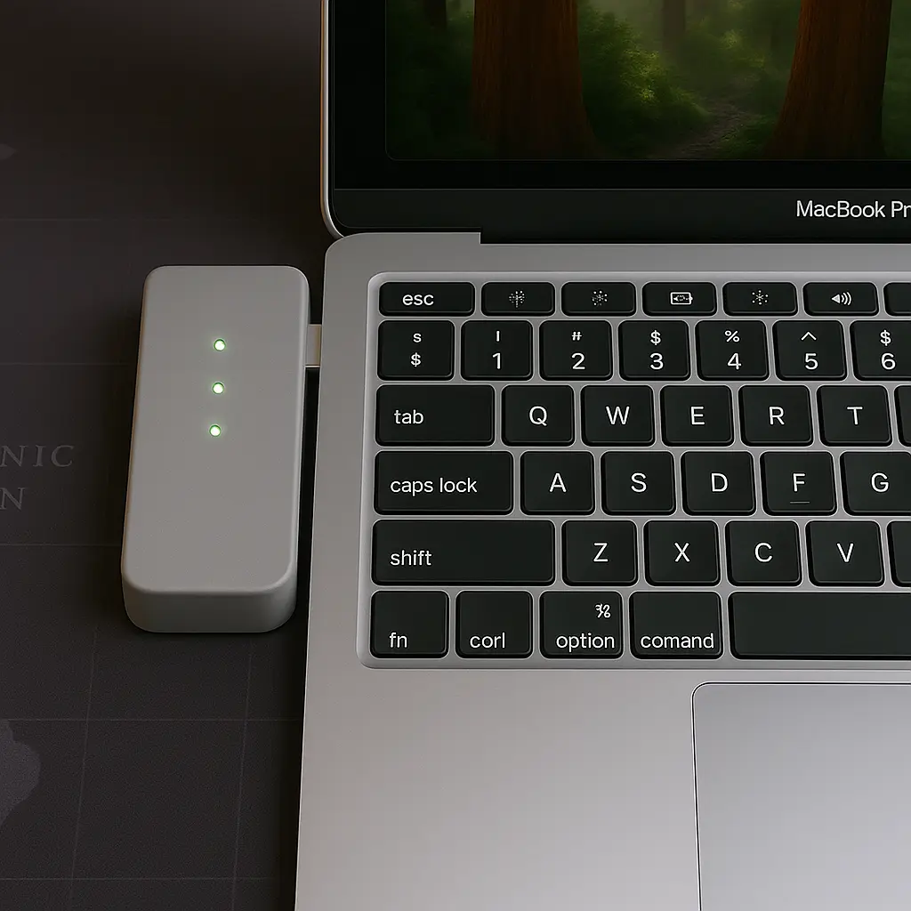
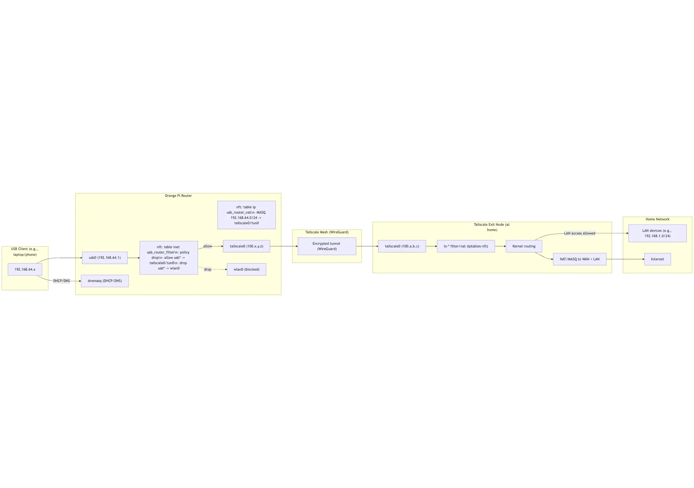
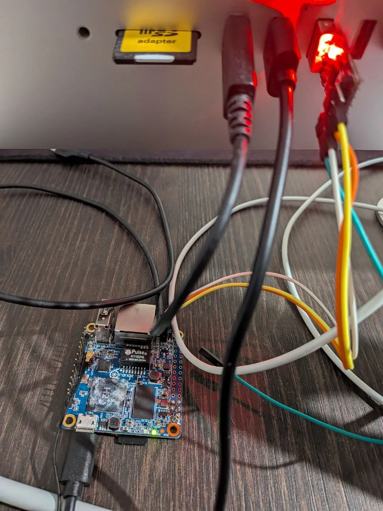
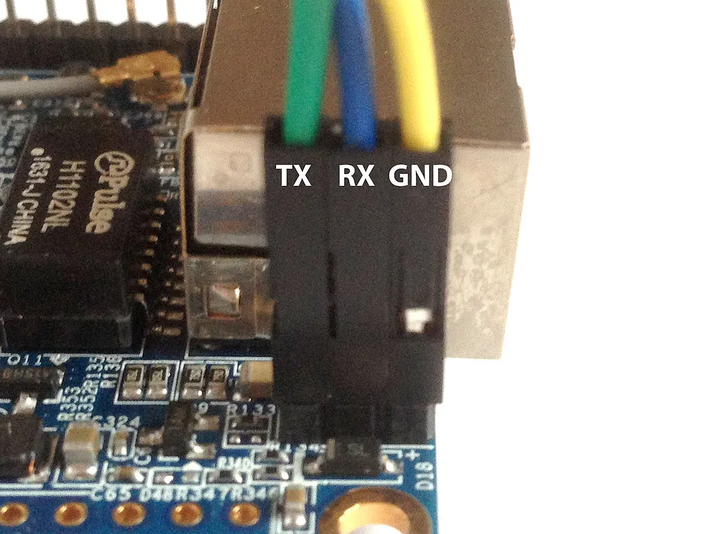
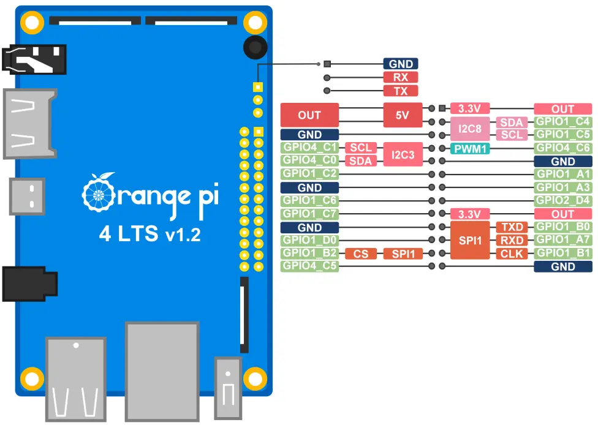

# HomeSteadyLink — Firmware

Firmware for the HomeSteadyLink travel router (Orange Pi Zero 2W):
stock Armbian Ubuntu 24.04 + the `/opt/homesteadlink/` payload
(`hsl-provisiond`, systemd units, configs). The board is provisioned
and controlled from the HomeSteadyLink mobile app over Bluetooth Low
Energy (BLE), or from the web app over USB.

- **Current release: v1.3** —
  [github.com/HomesteadLink/firmware/releases/tag/v1.3](https://github.com/HomesteadLink/firmware/releases/tag/v1.3)
- **Mobile app (BLE control plane):** [HomesteadLink/mobile-app](https://github.com/HomesteadLink/mobile-app)
- **Web app (USB control):** [homesteadlink.github.io/web-app](https://homesteadlink.github.io/web-app/)
- **GATT contract:** [`spec/gatt.md`](spec/gatt.md) — the single source of
  truth for firmware, Android, and iOS.




## Who it's for and core value

- **Who:** digital nomads, founders, traders, streamers, journalists,
  ad buyers, QA teams, remote employees needing a "home-like" IP.
- **Zero setup on the host:** plug in via USB; macOS/Windows/Linux see
  the board as a wired adapter (virtual Ethernet).
- **Residential IP egress:** traffic exits from a stable residential/home
  IP (your own node or managed pool).
- **Local network:** connect multiple devices to the box; all share the
  same residential IP.
- **Deterministic networking:** consistent routing rules at the box
  instead of flaky per-device VPN configs.

## Download — v1.3

Released 2026-11-16 (WITA). The release asset is the board image —
flash it to a microSD card (see below).

- Asset: `homesteadlink-v1.3-orangepizero2w.img.xz`
- Size: 559,467,796 bytes
- SHA-256: `ea0d155c2250c955dae0aab4c7ce57e080051891b51079047c07cf2fcc01f114`
- Download: [v1.3 release](https://github.com/HomesteadLink/firmware/releases/tag/v1.3)

Verify the download before flashing:

```sh
sha256sum homesteadlink-v1.3-orangepizero2w.img.xz
# must match ea0d155c2250c955dae0aab4c7ce57e080051891b51079047c07cf2fcc01f114
```

## Flash — SD-card swap only

The SD-card swap is the **only** flash path. There is no remote
flash: the console password is derived from a secret on the SD card,
and the U-Boot console is physical UART only.

**Balena Etcher:** select the `.img.xz`, select the SD card, Flash.

**Command line** (replace `/dev/sdX` with the SD card device —
check twice):

```sh
xzcat homesteadlink-v1.3-orangepizero2w.img.xz | sudo dd of=/dev/sdX bs=4M status=progress conv=fsync
sync
```

## First boot

1. Insert the SD card, power the Orange Pi Zero 2W.
2. `hsl-firstboot` writes `/etc/homesteadlink/identity.json`
   (serial + setup code + console password + AP passphrase).
3. **Capture the HSL-IDENTITY line from the serial console.**
   At first boot — and again on a boot after an `HSL-RESET` factory
   reset — the serial console prints the full line: serial, setup
   code, and AP passphrase. The console password is shown as
   `<redacted>` on the console; it is on the device label and in
   `/etc/homesteadlink/identity.json` (root-only, on the device).
   On later boots only the serial prints. Save the line somewhere
   safe — the setup code is what the app pairs with, and the AP
   passphrase is what the setup Wi-Fi network needs.
4. The device advertises over BLE as `HSL-<serial last4>` for 300 s
   (and permanently until Wi-Fi is configured). Pair from the
   HomeSteadyLink app with the setup code. Or join the
   `HomesteadLink-<last4>` Wi-Fi network (passphrase = the AP
   passphrase) and open the setup page at
   `http://192.168.64.1:8080` (over USB) or
   `http://192.168.65.1:8080` (AP mode).

**Factory reset:** put an empty file named `HSL-RESET` on the SD
boot partition and reboot. Bonds, Wi-Fi/VPN config, and state are
wiped; identity and the device secret are kept, and the full
HSL-IDENTITY line prints again on the serial console.

## How it works

1. **USB gadget mode**: configfs composite ACM+ECM+RNDIS — the host
   sees a wired adapter (`usb0`, 192.168.64.1/24; DHCP 192.168.64.50–.150).
2. **BLE provisioning**: `hsl-provisiond` serves the GATT contract
   (`spec/gatt.md`): LE Secure Connections, bonding required, the
   6-digit setup code is the pairing passkey, and the first bonded
   peer is the only owner. The app pushes Wi-Fi and VPN config over BLE.
3. **VPN**: WireGuard (`wg-hsl`) or Tailscale (`tailscale0`).
4. **Kill switch**: forwarded client traffic may leave only via a VPN
   interface (nftables forward policy is drop). No VPN = no client egress.
5. **Setup pages**: the config page is served on `usb0` and (in AP mode)
   on `wlan0` at port 8080.

## Build from source

See [`firmware/build/README.md`](firmware/build/README.md) — the build
runs `build-image.sh` (spec §F1/F2/F3 assertions run inside the build
and fail it on a miss) and produces
`out/homesteadlink-orangepizero2w-<date>.img.xz` (+ sha256).

## Hardware notes

### Orange Pi Zero 2W

https://www.armbian.com/orange-pi-zero-2w/

### Orange Pi Zero pinout reference




**Connection notes:**
- Use the micro-USB port (not the USB-A port) for gadget mode.
- UART pins for console access: TX (pin 8), RX (pin 10), GND (pin 6).
- Power can be supplied through micro-USB or GPIO pins.

### Orange Pi 4 LTS



Notes for the 4 LTS live in [orangepi4lts-rndis.md](orangepi4lts-rndis.md).
The v1.3 release image targets the Orange Pi Zero 2W.

## Status

- **v1.3**: delivered publicly via the GitHub Release above.
- **v1.4.0**: built 2026-11-15 (FunctionFS USB vendor interface — the
  USB transport the web app uses). Not yet released; flash +
  end-to-end test on real hardware is pending.
- **Waitlist-first**: there is no paid order path yet. Open issues:
  [#2](https://github.com/HomesteadLink/firmware/issues/2) (domain),
  [#4](https://github.com/HomesteadLink/firmware/issues/4) (pre-sale /
  Stripe — waitlist-first), [#5](https://github.com/HomesteadLink/firmware/issues/5)
  (marketing email).

## License

MIT License - see LICENSE file for details.
